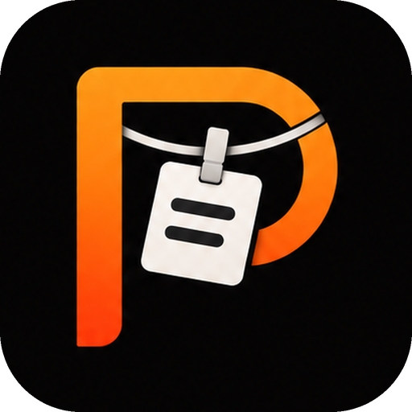

<p align="center"></p>

# Pegline

**Everything you copy, hung on a line.** A keyboard-first, local clipboard history and library for Windows.

Pegline pegs your images, texts and links onto three lines that slide down from the top of the screen. Your recent copies are always one key away, the ones that matter stay in a local Library, and you can drive all of it from the keyboard.

> Native .NET 10 / WPF. No Electron, no cloud. Your data stays in `%LOCALAPPDATA%\Pegline`.

## Status

`0.1.3`. What is finished is tracked in [ROADMAP.md](ROADMAP.md).

## Install and update

Download `PeglineApp-win-Setup.exe` from [Releases](https://github.com/KYRYZUM/pegline/releases) and run it. It needs no administrator rights, installs to `%LOCALAPPDATA%\PeglineApp` and adds desktop and Start menu shortcuts. Your Library lives in a separate folder (`%LOCALAPPDATA%\Pegline`); uninstalling or updating never touches it.

The installed app looks for a new version at launch and every hour (you can turn this off in Settings › Updates). A new version shows up as a notification and in the tray menu; nothing is downloaded or installed until you choose "Install and reopen", and later versions download only what changed (delta packages). While the repository is private, updates need a GitHub token with `Contents: Read-only` saved in Settings › Updates; the token is encrypted for your Windows account (DPAPI).

The installer is not code-signed yet, so Windows SmartScreen may ask for "More info › Run anyway" the first time. Once a certificate is available, `scripts/pack.ps1 -SignParams "..."` signs it.

## Features

- Three shelves (Images / Texts / Links) with sagging ropes and pegs; cards fill the screen width at the chosen card size and page when they run out of room
- Clipboard capture: text, a lone URL → Links, images (PNG / DIB; copies that carry an address or text next to the image, such as a browser's "Copy image", keep the image). Image files copied in Explorer are collected too (the originals never change); other file copies, concealed and password-manager copies and copies marked "exclude from history" are ignored; Pegline never recaptures its own copies
- Copying the same text again does not add a new card (identity ignores line-ending style and Unicode composition)
- Keyboard: arrows, `Tab`, `1–9`, `Alt+←/→`, `Ctrl+←/→`, `Shift+arrows`, `Ctrl+A`, `Enter`, `Ctrl+C`, `Ctrl+Enter` (paste into the previous app), `P`, `F`, `S`, `Backspace`, `Delete`, `Shift+S` (search), `Shift+I/T/L`, `Ctrl+Shift+B`, `Esc`
- Clicking a card copies it; `Ctrl`+click builds a selection that can skip cards and span shelves, `Shift`+click selects a range, double-click previews
- `Space` preview: image zoom (100–400%) and panning, in-place text editing (`E`), open a link in the browser (`Ctrl+O`)
- `Ctrl+K` Actions palette: every command, searchable, with its shortcut
- Library (`L`, tray, or the button on the shelves): grid / list, My library, Favorites, Unorganized, Recent copies, Trash, folders, tags, search, kind filters, sorting, an auto-saving details pane, notes and a recoverable Trash
- Organizing: `Shift+P` pin to a folder (recent folders first, `Ctrl+N` new folder), `Alt+P` name and pin (one by one for a selection), `Ctrl+Shift+T` add or create tags
- `Ctrl+Shift+E` exports copies (never overwrites a file). Drag and drop: images as files, text and links as text, or as .txt / .url files when the drag starts with `Ctrl` held; in the Library, drop items on a sidebar folder to add them
- `Ctrl+Enter` pastes only into the same field of the previous app; password fields and changed targets are refused (UI Automation; the field's content is never read)
- Image markup (`M`) and crop (`C`): pen, highlighter, rectangle, ellipse, arrow, line, text; color, stroke width, fill and text size; the original file never changes and marks stay editable
- Screen capture (`Ctrl+Alt+A`), the Windows Screenshots folder and up to three watched folders; text in images is recognized on the device (Windows OCR), searchable and copied with `Ctrl+Shift+C`, which also hangs it on the Texts shelf
- Visual search: find images in the Library by what they show ("red car", "a cat on a sofa") with Apple MobileCLIP-S2, entirely on the device (ONNX Runtime, CPU). Indexing runs at low priority on one core and waits while a full-screen app (a game or a video) is in front
- Link previews: title, site, author and thumbnail (YouTube included); only public HTTPS pages are fetched, local-network links and links carrying keys or tokens never are
- Screen recordings (MP4 / MOV): copy from Explorer, drop on the Library, or let the Snipping Tool's recordings folder bring them in; play them in the preview and trim without touching the original
- Library filter panel: where to search (text and visual / text and OCR only / visual only), date added, domain, tags (all must match), pinned only
- History length per kind; pinned, filed or tagged items never expire
- Global shortcuts (`Ctrl+Alt+T` shelves, `Ctrl+Alt+S` search), tray icon, single instance
- Settings (`Ctrl+,`, the tray, the Actions palette or the button on the shelves): General (language, visible shelves, soft colors / neutral glass, card size, bring the shelves down at the top edge and for new copies — every copy, images only or never — over full-screen apps, sounds, start at sign-in), History (per-kind retention, clear unsaved copies), Sources (clipboard, link previews, screenshots and recordings, indexing, watched folders), Keyboard shortcuts (recorder for global and navigation shortcuts, conflict checks), Updates, About
- Nine languages: English, Türkçe, Español, Français, Português (Brasil), Azərbaycan dili, 简体中文, 日本語, 한국어; the Windows display language by default

## Development

```powershell
pwsh scripts/prepare-search-models.ps1   # visual search models (once, 383 MB, SHA-256 verified)
dotnet test                              # core and behavior tests
dotnet run --project src/Pegline.App
pwsh scripts/pack.ps1 -Version 0.1.0     # Setup.exe, portable zip and update packages under Releases\
```

To release: `git tag v0.2.0 && git push origin v0.2.0`. The `Release` workflow runs the tests, prepares the models, builds a delta package against the previous version and publishes the GitHub release.

The visual search models (`assets/CLIP`, outside Git) come from this repository's `models-mobileclip-s2-v1` release and are bundled at build time; the running app never downloads anything or sends queries anywhere. Without them Pegline still builds and runs, with visual search turned off.

Debug builds keep their data in a separate `Pegline Dev` folder. The `PEGLINE_PIN_SHELVES=1` environment variable keeps the shelves open when they lose focus (for screenshots and debugging). In a Debug build, `Pegline.exe --ocr image.png out.txt` runs OCR on one file; `--clip-check out.txt` checks the model export (red circle / blue square ranking, speed); `--visual-search "description" out.txt` indexes the development Library and searches it; `--links out.txt <url…>` tries link previews; `--recording video.mp4 out.txt` tries import and trimming; `Pegline.exe --snapshot <library|library-recent|library-recent-list|shelves|picker-folder|picker-tag|picker-name|markup|markup-crop|library-filters|settings-general|settings-history|settings-sources|settings-shortcuts|settings-updates|settings-about> out.png` draws a window off-screen to a PNG without taking focus.

## Layout

| Project | Contents |
| --- | --- |
| `src/Pegline.Core` | Model, SQLite store, media store, clipboard admission rules, text identity, shelf navigation state machine, keymap, Library queries, pickers, export and paste policy. No UI dependencies. |
| `src/Pegline.App` | The WPF app: shelf window, Win32 clipboard listener, global shortcuts, focus hand-back, tray. |
| `tests/Pegline.Core.Tests` | xUnit: shelf navigation, Library keyboard, capture rules, history cleanup, the store, settings and translations. |

## Code signing policy

How releases are built, who approves them and what Pegline sends over the network: [CODE_SIGNING_POLICY.md](CODE_SIGNING_POLICY.md).

## License

Pegline is released under the [MIT License](LICENSE), © 2026 Enes Sarı. Third-party components come with their own licenses: [THIRD_PARTY_NOTICES.md](THIRD_PARTY_NOTICES.md).

Contributions are welcome; please follow the [Code of Conduct](CODE_OF_CONDUCT.md).

Pegline is an independent app. The idea of clipboard shelves was inspired by [ClipBoardLine](https://github.com/orkunisitmak/clipboardline-desktop) and [Tendedero](https://github.com/alejandrobujan/tendedero); none of their code or files are used.
